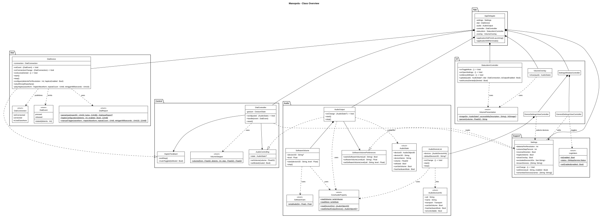
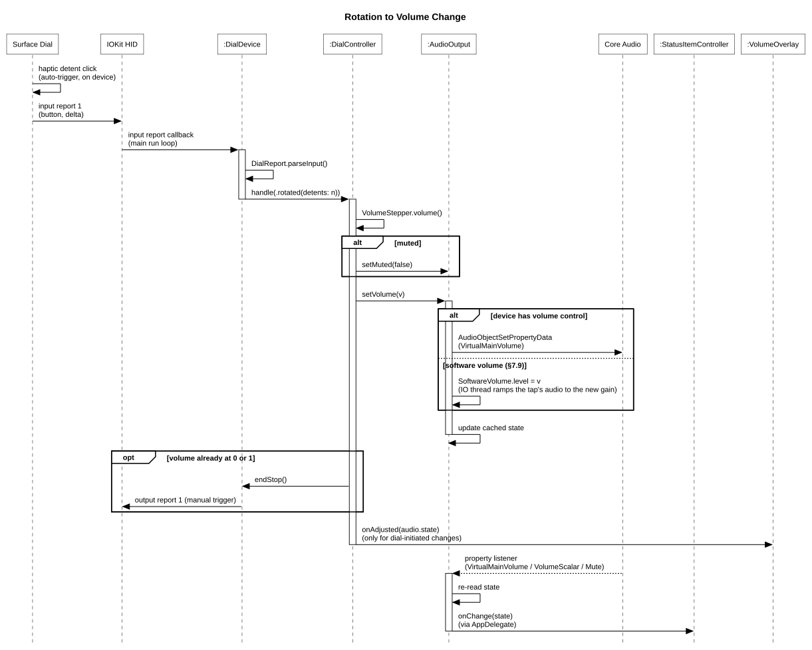
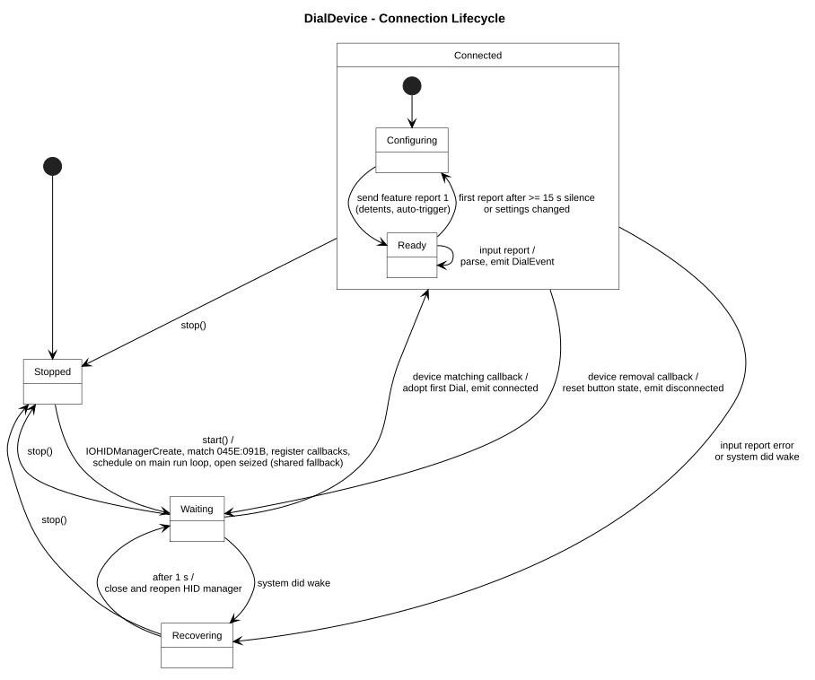
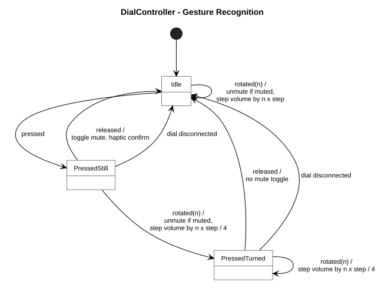

# Manopola — Software Design Document

| | |
|---|---|
| **Status** | Draft 0.1 |
| **Date** | 2026-10-17 |
| **Author** | Heiko Panjas |
| **Product** | Manopola (working name), macOS menu bar app |
| **Bundle ID** | `com.panjas.Manopola` |

> *Manopola* is Italian for "knob". The name is a placeholder; renaming touches `project.yml`, the source folder and this document only.

---

## 1. Purpose and Scope

Manopola turns a Microsoft Surface Dial into a hardware volume knob for the Mac:

- turning the Dial changes the volume of the current default output device,
- pressing the Dial toggles mute,
- the Dial's built-in haptic motor gives a detent click per step.

Planned from M6 (§13): the menu lists output and input devices with their battery levels and switches between them, and one input device can be kept active when macOS would switch to a newly connected headset.

The app is a native AppKit menu bar utility with no third-party dependencies. This document is the hand-off specification for implementation: it records what is known about the hardware, the decisions taken, the architecture, and the open points that must be verified on real hardware first.

## 2. Background: The Surface Dial on macOS

### 2.1 Hardware

| Property | Value |
|---|---|
| Vendor / Product ID | `0x045E` / `0x091B` |
| Transport | Bluetooth LE (HID over GATT), requires Bluetooth 4.0. Verified 2026-10-18: IOKit reports transport "Bluetooth Low Energy", primary usage Generic Desktop `0x0E`, max input / output / feature report sizes 73 / 73 / 53 bytes (the vendor collections are larger than report 1) |
| Sleep and wake | Verified 2026-10-18: the Dial disconnects 4 min 57 s after the last input report (touch released), three times out of three. On wake, macOS needs about 1.6 s from the first advertisement to the HID device match (link 1 ms, encryption 0.29 s, link ready 0.63 s, HID setup 1.0 s); Manopola's share is under 1 ms. The turn that wakes the Dial is lost. macOS reads the battery level over Bluetooth (System Information shows it). |
| Power | 2 × AAA |
| Controls | rotation (relative, up to 3600 steps per revolution), one push button |
| Feedback | haptic motor, controllable via HID haptics usage page `0x0E` |
| Availability | discontinued; buy used or open-box |

The Dial pairs with macOS like any Bluetooth input device, but macOS has no driver logic for it: the generic HID path turns its reports into invalid mouse input. Every working macOS solution therefore opens the device directly through IOKit HID and interprets the raw reports itself. That is what Manopola does.

### 2.2 Prior Art

| Project | Approach | Taken over | Avoided |
|---|---|---|---|
| **Mac Dial** (`andreasjhkarlsson/mac-dial`, fork `drashna/mac-dial`) | hidapi fork read on a dedicated blocking thread; synthesizes media keys via `CGEvent`; "scroll" and "playback" modes | report layout, haptic feature report | extra thread and retry loop for discovery; Accessibility permission for synthetic keys; step size fixed by macOS (1/64 with Shift+Option); unsigned builds, so macOS drops the Accessibility grant after every update |
| **OrbitLauncher** Surface Dial preview (`S7venYoung/RingLauncher`, tag `v0.2.0-dial.1`) | `IOHIDManager` on the main run loop; reads the resolution multiplier; configures haptic detents | event-driven HID session, haptic re-configuration after Dial idle sleep, HID session rebuild after Mac wake | — |
| **surface-dial-linux** (`daniel5151/surface-dial-linux`) | Linux user-space daemon | the dumped HID report descriptor (`notes/HID_Report_Descriptor.txt`) and haptics report encoding — the authoritative layout source for §7.1 | — |

Mac Dial's playback mode does volume plus play/pause, but has no mute and goes through synthetic media keys. Manopola talks to Core Audio directly instead, which needs no Accessibility permission, allows arbitrary step sizes, and makes mute a first-class action.

## 3. Goals and Non-Goals

### Goals

1. Control output volume and mute with the Dial, with haptic detents.
2. Follow whatever device is the current default output, including changes while running (AirPods connecting, display audio, USB interface).
3. Stay in sync with volume and mute changes made elsewhere (keyboard, Control Center, other apps).
4. Survive Dial idle sleep, Bluetooth reconnects, and Mac sleep/wake without user action.
5. Zero idle CPU: fully event-driven, no polling.
6. No Accessibility permission, no third-party dependencies, no network access.
7. Planned: show and switch output and input devices from the menu, with battery levels, and keep a chosen input active (FR-19 to FR-21).

### Non-Goals (v1)

- Scroll mode, media transport (play/pause/next), or per-app volume.
- Radial on-screen menus as on the Surface Studio.
- Multiple Dials at once (the first one matched is used).
- Mac App Store distribution.

## 4. Requirements

### Functional

| ID | Requirement |
|---|---|
| FR-1 | Detect a paired and connected Surface Dial automatically; reconnect automatically after it disappears. |
| FR-2 | Each rotation detent changes the default output volume by the configured step (default 2 %). |
| FR-3 | A short press (press and release without rotation) toggles mute of the default output device. |
| FR-4 | Rotating while the button is held adjusts by a quarter step (fine mode) and suppresses the mute toggle on release. |
| FR-5 | Any rotation while muted unmutes first, as the macOS volume keys do. |
| FR-6 | Track the default output device live. |
| FR-7 | Reflect external volume and mute changes in the menu bar icon and menu. |
| FR-8 | Haptic detents can be switched off; end-stop and mute toggles produce distinct haptic feedback. |
| FR-9 | Menu bar icon shows volume level, mute state, and whether the Dial is connected. |
| FR-10 | Optional on-screen overlay for Dial-initiated changes. |
| FR-11 | Settings window for all options in §7.7. |
| FR-12 | Launch at login. |
| FR-13 | A Devices settings tab lists every output device with its connection type and whether it supports volume control and mute; the user selects which devices the Dial works with. New devices are selected by default. On an unselected default output, turning and pressing do nothing. |
| FR-14 | Devices without volume control can get software volume, opt-in per device: the Dial then controls a software gain applied to the audio sent to the device (§7.9). |
| FR-15 | Turning the Dial on a device it cannot control plays the end-stop buzz once per gesture, so the user knows nothing will change. |
| FR-16 | While the Mac is in use, Manopola keeps the Dial out of its idle sleep, so the first turn is not lost to the reconnect. On by default; can be turned off in Settings (§7.14). |
| FR-18 | The menu shows the Dial's battery level, read from the Bluetooth Battery Service (§7.10). |
| FR-19 | Planned (M6, M7). The menu lists the connected output and input devices; the default output and the default input are shown in bold, Bluetooth devices show their battery level, and clicking a device makes it the default (§7.11, §7.12). |
| FR-20 | Planned (M6). The menu shows the current default input device between the output and volume lines (§5.3). |
| FR-21 | Planned (M8). The user can choose one input device that is kept active: while it is connected, Manopola reverts every change of the default input to it (§7.13). |

### Non-Functional

| ID | Requirement |
|---|---|
| NFR-1 | Latency from HID report to Core Audio call under 5 ms on the main thread. |
| NFR-2 | No timers or polling while idle; idle CPU is 0 %. Exceptions: while software volume runs (opt-in, §7.9), audio IO runs continuously; while keep-awake runs (Dial connected, displays awake, §7.14), one timer fires every 3 minutes. |
| NFR-3 | Builds clean in Swift 6 language mode with complete concurrency checking. |
| NFR-4 | Passes `swift-format lint` with the repository `.swift-format`. |
| NFR-5 | No third-party packages. Frameworks: AppKit, IOKit, CoreAudio, AudioToolbox, ServiceManagement, OSLog. |
| NFR-6 | Signed with a stable Developer ID so privacy grants survive updates. |

## 5. Interaction Design

### 5.1 Gestures

| Gesture | Action | Haptics |
|---|---|---|
| Turn clockwise | volume up one step per detent | detent click (device-generated) |
| Turn counter-clockwise | volume down one step per detent | detent click |
| Turn while muted | unmute, then step | detent click |
| Short press | toggle mute | mute: double click; unmute: single click |
| Press and turn | fine adjust, quarter step per detent; no mute toggle on release | detent click |
| Turn past 0 % or 100 % | nothing changes | short end-stop buzz (100 ms) once; it repeats only after a pause of at least 300 ms between end-stop detents |

"Reverse direction" in Settings swaps the meaning of clockwise and counter-clockwise.

### 5.2 Menu Bar Icon

The icon is a knob, not a speaker, so it cannot be confused with the system Sound item (decided 2026-10-18 after a quick test with the SF Symbols `dial.*` positions). `KnobIcon` draws it as an 18 pt vector template image in one of three styles, chosen in Settings (§7.6):

| Style | Look |
|---|---|
| Arc (default) | filled knob with a cut-out pointer, inside a 270° arc that is lit up to the level, like the app icon |
| Ring | outlined circle with a pointer line |
| Dots | filled knob with a cut-out pointer and seven scale dots lit up to the level |

The pointer sweeps 270° clockwise from lower left (0 %) to lower right (100 %). Unlit parts use 30 % alpha, which the template tint keeps.

| State | Knob |
|---|---|
| Volume adjustable, not muted | pointer and lit part at the volume |
| Muted | outlined knob with a slash, no pointer, nothing lit |
| Output device without any volume control | knob at full (the device plays at its fixed level), button `appearsDisabled = true` |
| No output device | knob at minimum, button `appearsDisabled = true` |
| Dial not connected, or in use by another app | current knob, button `appearsDisabled = true` |
| Current output unselected in the Devices tab | current knob, button `appearsDisabled = true`, accessibility text adds ", Dial off for this output" |

### 5.3 Menu

```
Surface Dial: Connected, battery 85 %  (disabled info item; or Not Connected, or In Use by Another App)
Output: MacBook Pro Speakers       (disabled info item; "(Dial off)" appended when unselected)
Volume: 42 %                       (disabled info item)
─────────────
Mute                         ✓     (toggles mute; state reflects mute)
─────────────
Settings…                    ⌘,
About Manopola
─────────────
Quit Manopola                ⌘Q
```

**Planned menu (M6 to M8, FR-19 to FR-21):**

```
Surface Dial: Connected, battery 85 %
Output: AirPods Pro
Input: MOTU M2 (kept)              (new info line, between output and volume)
Volume: 42 %
─────────────
Output                             (section header)
  AirPods Pro            L 80 %, R 75 %, case 40 %     (bold: default output)
  MacBook Pro Speakers
  MOTU M2
Input                              (section header)
  AirPods Pro            L 80 %, R 75 %, case 40 %
  MacBook Pro Microphone
  MOTU M2                                              (bold: default input)
─────────────
Mute                         ✓
─────────────
Settings…                    ⌘,
About Manopola
─────────────
Quit Manopola                ⌘Q
```

The Input line reads "Input: None" without an input device and appends "(kept)" when the default input is the kept device (§7.13). Device items are commands, so they use the regular menu font and label color; details in §7.11.

The three status lines use the menu font at the small system size and the secondary label color, so they read as information rather than commands; their text is always set through `attributedTitle`. The battery part appears only while the level is known (§7.10). The menu is built once. `NSMenuDelegate.menuNeedsUpdate(_:)` refreshes titles and states right before display. When HID access is denied (§9.2), an extra item "Allow Input Monitoring…" appears below the Dial status line. Without an output device the lines read "Output: None" and "Volume: –". "Mute" is disabled when the device has neither a mute control nor software volume. The menu's Mute item sets mute on `AudioOutput` directly, without haptics or overlay, which belong to Dial gestures.

### 5.4 Volume Overlay

Because Manopola sets the volume through Core Audio, the system volume HUD does not appear. Manopola shows its own overlay for Dial-initiated changes only; changes made with the keyboard keep showing the system HUD, so the two never stack.

- `NSPanel`, style `[.borderless, .nonactivatingPanel]`, `level = .statusBar`, `ignoresMouseEvents = true`, `collectionBehavior = [.canJoinAllSpaces, .fullScreenAuxiliary, .stationary, .ignoresCycle]`.
- Content: `NSVisualEffectView` (material `.hudWindow`, rounded 18 pt) with the knob from §5.2 at 72 pt in the selected style (tinted with the label color), a 16-segment level bar, and the percentage. 200 × 200 pt.
- Placement: horizontally centered on the screen that contains the mouse pointer, 140 pt above the bottom of its `visibleFrame`.
- Shown immediately, faded out over 0.3 s after 1.5 s without further Dial input (`NSAnimationContext`). A single panel instance is reused.

## 6. Architecture



Source: [`diagrams/class-overview.puml`](diagrams/class-overview.puml)

| Module | Responsibility |
|---|---|
| **App** | `main.swift` creates `NSApplication` and installs `AppDelegate`. `AppDelegate` owns all long-lived objects, wires their callbacks, starts and stops them. No storyboards or nibs. |
| **Dial** | `DialDevice` owns the IOKit HID session for the Dial: discovery, input reports, feature/output reports, reconnection. `DialReport` is a pure encoder/decoder for the byte layouts. `DialEvent` is the device-independent event vocabulary. `DialBattery` reads the battery level, `DialKeepAwake` keeps the Dial awake while the Mac is in use. |
| **Control** | `DialController` is the gesture recognizer and the only place that decides what a Dial event does. It depends on two protocols (`AudioControlling`, `HapticFeedback`) so it can be unit-tested without hardware. `VolumeStepper` holds the step math. |
| **Audio** | `AudioOutput` wraps Core Audio for the default output device: read and write volume and mute, observe device and property changes, publish `AudioState`. |
| **UI** | `StatusItemController` (NSStatusItem and menu), `VolumeOverlay` (HUD panel), `SettingsWindowController` (preferences window). |
| **Support** | `Settings` (typed `UserDefaults` wrapper), `LoginItem` (`SMAppService.mainApp`), `Log` (`os.Logger` categories). |

Data flows one way: **DialDevice → DialController → AudioOutput → (Core Audio listener) → AudioOutput.onChange → StatusItemController**. The only reverse paths are haptic commands from `DialController` back to `DialDevice` and `onAdjusted` to the overlay.



Source: [`diagrams/rotate-sequence.puml`](diagrams/rotate-sequence.puml)

## 7. Detailed Design

### 7.1 HID Protocol

All multi-byte fields are little-endian. Report layouts follow the dumped report descriptor (top-level usage Generic Desktop `0x0E` "System Multi-axis Controller", logical collection Digitizer `0x21` "Puck").

**Input report 1 — state** (8 bytes payload, 9 with report ID)

| Byte | Bits | Usage | Meaning |
|---|---|---|---|
| 0 | — | Report ID | `0x01` |
| 1 | 0 | Button 1 | 1 = pressed |
| 1 | 1 | Digitizer Touch | on-screen contact (Surface Studio only; ignore) |
| 1 | 2–7 | — | padding |
| 2–3 | — | Generic Desktop Dial (`0x37`) | signed 16-bit relative rotation delta; positive = clockwise |
| 4–5 | — | X | on-screen position, null state; ignore |
| 6–7 | — | Y | on-screen position, null state; ignore |
| 8 | — | Digitizer Width | constant 58; ignore |

The delta unit is 1 / *R* of a revolution, where *R* is the resolution multiplier from the feature report. Manopola sets *R* = detents per revolution, so a delta of ±1 is exactly one detent. A fast turn can arrive as one report with |delta| > 1; it is handled as that many detents.

**Feature report 1 — resolution and haptics configuration** (7 bytes payload, 8 with report ID)

| Byte | Usage | Value written by Manopola |
|---|---|---|
| 0 | Report ID | `0x01` |
| 1–2 | Resolution Multiplier (Generic Desktop `0x48`), 0…3600 | detents per revolution (default 36) |
| 3 | Haptics Repeat Count (`0x0E:0x24`) | `0x00` |
| 4 | Haptics Auto Trigger (`0x0E:0x20`), waveform ordinal 1…7 | `0x03` (click) when haptic detents are on, `0x02` (stop/none) when off |
| 5 | Haptics Waveform Cutoff Time (`0x0E:0x28`) | `0x00` |
| 6–7 | Haptics Retrigger Period (`0x0E:0x25`), 0…2000 | `0x0000` |

**Output report 1 — manual haptic trigger** (4 bytes payload, 5 with report ID)

| Byte | Usage | Meaning |
|---|---|---|
| 0 | Report ID | `0x01` |
| 1 | Haptics Repeat Count (`0x0E:0x24`) | additional repetitions (0 = play once) |
| 2 | Haptics Manual Trigger (`0x0E:0x21`) | waveform ordinal: 3 = click, 4 = buzz |
| 3–4 | Haptics Retrigger Period (`0x0E:0x25`) | milliseconds between repetitions |

Waveform ordinals per the descriptor's waveform list: 3 → `0x1003` (Click), 4 → `0x1004` (Buzz Continuous). Ordinals 1 and 2 are the HID-defined None and Stop.

**Observed on hardware (2026-10-18, 36 detents, debug capture of 236 input reports):**

- Input report 1 always arrives as 9 bytes with the report ID first (R1).
- Byte 1 bit 1 (Digitizer Touch) is set in most reports during normal use, not only on a Surface Studio; the parser already ignores it.
- Bytes 4–7 are constant `0A 0B 0C 0D`, byte 8 is `0x3A` (58).
- Every delta is `0x0001`, `0xFFFF` or `0x0000`; fast turns arrive as a quick series of ±1 reports, not as one larger delta.
- Each button press also sends input report ID 50 (`0x32`), 2 bytes, always `32 02`. It is not part of the layouts above and is ignored.
- Manual triggers are accepted. Click with repeat 1 at 120 ms plays as a distinct double click. Buzz (ordinal 4) is *continuous*: it keeps playing until another haptic replaces it, such as the next detent click or a manual trigger (R4).

Feature report 2 (Auto Trigger Associated Control = `0x00010037`, the Dial axis) and the vendor collections `0xFF07` (report IDs 42, 48) are not used.

**Haptic patterns used**

| Pattern | Report | Bytes |
|---|---|---|
| Detent click | automatic, from feature report 1 | — |
| Unmute | output 1, click, repeat 0 | `01 00 03 00 00` |
| Mute | output 1, click, repeat 1, 120 ms | `01 01 03 78 00` |
| End stop | output 1, buzz, repeat 0; then output 1, Stop, 100 ms later | `01 00 04 00 00`, then `01 00 02 00 00` |

### 7.2 DialDevice



Source: [`diagrams/dial-lifecycle.puml`](diagrams/dial-lifecycle.puml)

```swift
enum DialEvent: Equatable {
    case rotated(detents: Int)  // positive = clockwise, before direction preference
    case pressed
    case released
}

enum HapticWaveform: UInt8 {
    case stop = 2
    case click = 3
    case buzz = 4
}

struct DialInputReport: Equatable {
    let isPressed: Bool
    let delta: Int16
}

enum DialReport {
    static let vendorID = 0x045E
    static let productID = 0x091B
    static let reportID: UInt8 = 0x01

    static func parseInput(reportID: UInt32, bytes: [UInt8]) -> DialInputReport?
    static func hapticConfiguration(detentsPerRevolution: Int, hapticsEnabled: Bool) -> [UInt8]
    static func manualTrigger(waveform: HapticWaveform, repeatCount: UInt8, retriggerMilliseconds: UInt16) -> [UInt8]
}

enum DialConnection: Equatable {   // DialConnection.swift
    case notConnected
    case connected
    case inUseElsewhere   // present, but another process holds it exclusively
}

final class DialDevice: HapticFeedback {
    var onEvent: ((DialEvent) -> Void)?
    var onConnectionChange: ((DialConnection) -> Void)?
    var onAccessDenied: (() -> Void)?
    private(set) var connection: DialConnection
    var isConnected: Bool { get }   // connection == .connected

    func start()
    func stop()
    func retryIfInUseElsewhere()
    func configure(detentsPerRevolution: Int, hapticsEnabled: Bool)
    func playHaptic(_ waveform: HapticWaveform, repeatCount: UInt8, retriggerMilliseconds: UInt16)
    func sendKeepAlive()   // §7.14
}
```

**Session setup**

1. `IOHIDManagerCreate(kCFAllocatorDefault, kIOHIDOptionsTypeNone)`.
2. `IOHIDManagerSetDeviceMatching` with `kIOHIDVendorIDKey = 0x045E`, `kIOHIDProductIDKey = 0x091B`.
3. Register matching, removal and input-report callbacks (`IOHIDManagerRegisterDeviceMatchingCallback`, `…RemovalCallback`, `…InputReportCallback`) with `Unmanaged.passUnretained(self)` as context. `DialDevice` lives for the whole app lifetime, so the unretained context is safe; `stop()` unregisters before the object could go away.
4. `IOHIDManagerScheduleWithRunLoop(manager, CFRunLoopGetMain(), CFRunLoopMode.commonModes)`. All callbacks therefore arrive on the main thread.
5. `IOHIDManagerOpen(manager, kIOHIDOptionsTypeSeizeDevice)`. Seizing gives Manopola exclusive access and stops macOS from turning the Dial's reports into stray pointer events. If the open returns `kIOReturnExclusiveAccess`, open again with `kIOHIDOptionsTypeNone`. If it returns `kIOReturnNotPermitted`, follow §9.2.

**Report parsing.** `parseInput` accepts both buffer shapes seen on macOS: 9 bytes starting with `0x01` (report ID included) and 8 bytes when `reportID == 1` (ID stripped). Anything else returns `nil` and is logged at debug level. `DialDevice` keeps the last button state and emits `.pressed` / `.released` only on edges, then `.rotated(detents: Int(delta))` if `delta != 0`.

**Haptics configuration** is sent with `IOHIDDeviceSetReport(device, kIOHIDReportTypeFeature, 1, bytes, 8)` — the buffer includes the report ID byte. It is sent:

- on every device match,
- whenever `configure(...)` is called (settings changed),
- on the first input report after 15 s or more without reports. The Dial powers down when idle and may come back with its default configuration; re-sending 8 bytes is cheap and makes this robust.

Manual triggers use `IOHIDDeviceSetReport(device, kIOHIDReportTypeOutput, 1, bytes, 5)`. `HapticFeedback` conformance maps `endStop()` and `muteToggled(isMuted:)` to the patterns in §7.1 through `playHaptic(_:repeatCount:retriggerMilliseconds:)`; calls while disconnected are ignored. `endStop()` is debounced inside `DialController` (§7.3). Because the buzz waveform is continuous (§7.1), `endStop()` schedules a Stop trigger (ordinal 2) 100 ms after the buzz; any other `playHaptic` call within that window cancels the pending Stop, since its waveform replaces the buzz anyway. The user chose this short buzz over the three-click fallback: the Dial's own click feel is sluggish, which makes rapid click patterns hard to tell apart.

**Adoption.** A matching callback alone does not make the Dial usable. When another process has seized it, IOKit still reports the match, but `IOHIDManagerOpen` fails with `kIOReturnExclusiveAccess` in both modes and every report is refused (verified 2026-10-18 with two Manopola instances). The haptic configuration is the first report sent to a matched device, so its result decides:

- success, or a failure such as a Bluetooth timeout: the device is adopted and the state becomes `.connected`;
- `kIOReturnExclusiveAccess`: the device is remembered as blocked and the state becomes `.inUseElsewhere`; its removal returns the state to `.notConnected`;
- `kIOReturnNotOpen` or `kIOReturnNotPermitted`: logged, not adopted.

IOKit sends no notification when the other process releases the Dial, and polling is ruled out (NFR-2). `retryIfInUseElsewhere()` therefore rebuilds the manager on occasions the user causes: when the status menu opens and when the app becomes active. The published state is kept during that rebuild so the menu does not flicker; if `IOHIDManagerCopyDevices` then finds no Dial, the state becomes `.notConnected` right away. The Dial's own sleep and wake cycle and Mac wake cause a fresh match as well, which retries implicitly. Verified on hardware 2026-10-18: with two instances, the second reported `.inUseElsewhere` within the same second the first connected; after the first quit, opening the second's menu retried and connected in about 50 ms.

**Recovery.** On `NSWorkspace.didWakeNotification`, and when the input-report callback delivers a non-success `IOReturn`, schedule a rebuild 1 s later: unschedule, close, release, and re-create the manager. A pending rebuild is cancelled and rescheduled if another trigger arrives. Removal resets the button state and emits `onConnectionChange(.notConnected)`; `AppDelegate` then calls `DialController.reset()` so an in-flight press never toggles mute.

### 7.3 DialController



Source: [`diagrams/gesture-states.puml`](diagrams/gesture-states.puml)

```swift
protocol AudioControlling: AnyObject {
    var state: AudioState? { get }
    func setVolume(_ volume: Float32)
    func setMuted(_ muted: Bool)
}

protocol HapticFeedback: AnyObject {
    func endStop()
    func muteToggled(isMuted: Bool)
}

struct ControlSettings: Equatable {
    var stepPercent: Int
    var reverseDirection: Bool
}

final class DialController {
    var onAdjusted: ((AudioState) -> Void)?

    init(
        audio: any AudioControlling, haptics: any HapticFeedback,
        settings: @escaping () -> ControlSettings,
        now: @escaping () -> ContinuousClock.Instant = { ContinuousClock.now }
    )

    func handle(_ event: DialEvent)
    func reset()
}
```

**Gesture state:** `idle`, `pressedStill`, `pressedTurned` (see diagram). Rules:

1. `rotated(n)`: if `reverseDirection`, `n = -n`. Step size is `stepPercent / 100`, or a quarter of it while pressed. If there is no state or the device UID is in `excludedDeviceUIDs` (§7.6), do nothing. If `canSetVolume == false`, play the debounced end-stop buzz (FR-15) and change nothing. If muted, call `setMuted(false)` first. Compute the new volume with `VolumeStepper`. If it equals the current volume and the current volume is at 0 or 1 in the direction of travel, call `haptics.endStop()`, debounced with `now`: the buzz plays only if the previous end-stop detent is at least 300 ms old, so a continuous spin past the end buzzes once (checklist item 5). Otherwise `setVolume`. The step is computed from the state after unmuting, because unmuting an emulated mute restores the remembered volume. Then call `onAdjusted(audio.state)`. Rotating while pressed moves to `pressedTurned` even when the volume cannot change, so the release never toggles mute.
2. `pressed` → `pressedStill`.
3. `released` in `pressedStill` → if the device UID is in `excludedDeviceUIDs`, do nothing; otherwise toggle mute, `haptics.muteToggled(isMuted:)` with the new state, `onAdjusted`. In `pressedTurned` → only return to `idle`.
4. `reset()` → `idle`.
5. A mute toggle the device refuses (neither mute nor software volume) gives no haptic confirmation and no `onAdjusted`.

**VolumeStepper.** `VolumeStepper.volume(from:detents:step:) -> Float32`, a caseless enum. Volumes are snapped to the step grid in the direction of travel so that a level set elsewhere (e.g. 37 %) never produces an uneven first step. The math runs in `Double`; zero detents return the volume unchanged:

```
ε = 0.0001
base = detents > 0 ? floor((v + ε) / s) · s : ceil((v − ε) / s) · s
result = clamp(base + detents · s, 0, 1)
```

Test vectors (s = 0.02): 0.37 ↑1 → 0.38; 0.37 ↓1 → 0.36; 0.40 ↑1 → 0.42; 0.40 ↓1 → 0.38; 0.99 ↑1 → 1.00; 0.01 ↓3 → 0.00; 1.00 ↑1 → 1.00 (end stop). Fine mode (s = 0.005): 0.37 ↑1 → 0.375.

### 7.4 AudioOutput

```swift
struct AudioState: Equatable {
    var deviceID: AudioObjectID
    var deviceUID: String
    var deviceName: String
    var volume: Float32       // 0...1, virtual main volume
    var isMuted: Bool
    var canSetVolume: Bool
    var hasHardwareMute: Bool
}

final class AudioOutput: AudioControlling {   // conformance added in M3 with the protocol
    private(set) var state: AudioState?   // nil when there is no output device
    var onChange: ((AudioState?) -> Void)?

    func start()
    func stop()
    func setVolume(_ volume: Float32)
    func setMuted(_ muted: Bool)
}
```

**Default device.** Read `kAudioHardwarePropertyDefaultOutputDevice` on `kAudioObjectSystemObject`, and observe it with `AudioObjectAddPropertyListenerBlock` (queue `DispatchQueue.main`). On change: remove the listeners from the old device, attach them to the new one, re-read the state.

**Volume.** Use the virtual main volume, which Core Audio derives from the device's per-channel controls and which behaves like the system volume slider:

- read and write through `AudioObjectGetPropertyData` / `AudioObjectSetPropertyData` with `kAudioHardwareServiceDeviceProperty_VirtualMainVolume` (constant from AudioToolbox), scope `kAudioDevicePropertyScopeOutput`, element `kAudioObjectPropertyElementMain`. The HAL serves this property directly; the `AudioHardwareService…` functions are deprecated since macOS 10.11 and are not used;
- `canSetVolume` = `AudioObjectHasProperty` and `AudioObjectIsPropertySettable` both true. Many HDMI/DisplayPort outputs, some USB interfaces and aggregate devices have no software volume; those get the disabled state from §5.2 and rotation is ignored. Their `volume` is reported as 1, the fixed full level.

**Mute.**

- `hasHardwareMute` = `kAudioDevicePropertyMute` (scope output, element main) exists and is settable. Then mute is that property.
- Otherwise mute is emulated: remember the current volume keyed by `deviceUID` (in memory), set volume 0, report `isMuted = true`. Unmute restores the remembered volume. If the volume is changed to a non-zero value from elsewhere while emulated-muted, the emulated mute is cleared.

**Observation.** On the current device, listen with `AudioObjectAddPropertyListenerBlock` for the virtual main volume (as above), `kAudioDevicePropertyVolumeScalar` (scope output, element `kAudioObjectPropertyElementWildcard`) and `kAudioDevicePropertyMute` (scope output, element main). A device lacking one of them refuses that listener, which is logged at debug level. Any notification re-reads the full state; `onChange` fires only when the new `AudioState` differs from the cached one. If re-reading a newly selected device fails, the state becomes `nil` rather than keeping the previous device's values.

Core Audio identifies a listener by its block pointer. The listener closures are therefore stored once as `@convention(block)` values and the same instances are passed to add and remove.

**Writes** update the cached state immediately (optimistic) so `DialController` and the overlay see the new value without waiting for the listener round-trip; the listener then confirms or corrects it. Core Audio reads a written volume back with float noise (0.58 as 0.58000004); a re-read that differs from the cached volume of the same device by less than 0.0001 keeps the cached value, so it does not fire `onChange` a second time.

**Shared property access.** The Core Audio property helpers live in `CoreAudioProperty` (caseless enum): default output device, device list, output stream presence, hidden flag, transport type, UID and name strings, settability, volume and mute read and write, and the shared `ListenerBlock` type. `AudioOutput` and `AudioDeviceList` both use it.

**Device list.** `AudioDeviceList` lists the visible devices that have output streams as `AudioDeviceInfo` (UID, name, transport, `canSetVolume`, `hasHardwareMute`, computed `isControllable`) plus the default output UID. It listens to `kAudioHardwarePropertyDevices` and the default output device on the system object and reloads on any change. Only the Devices tab owns one, started in `viewWillAppear()` and stopped in `viewDidDisappear()`, so no listener stays registered while the tab is closed.

**Errors.** `CoreAudioError` and `OSStatus.throwIfError(_:)` are ported from Push to Hush (`CoreAudioSource.swift`), with the four-character-code rendering corrected to most-significant byte first. Failures are logged under the `audio` category; the cached state stays at the last confirmed value.

### 7.5 StatusItemController and VolumeOverlay

- `StatusItemController` creates an `NSStatusItem` with `squareLength`, sets the menu from §5.3 and implements `NSMenuDelegate`. `update(audio:dial:)` changes the button image, `appearsDisabled` and the Dial status line (so a retry result shows while the menu is open); the other menu titles are refreshed in `menuNeedsUpdate(_:)`. `menuWillOpen(_:)` calls `onMenuWillOpen`, which `AppDelegate` uses for `DialDevice.retryIfInUseElsewhere()`.
- Images: `VolumePresentation.knobImage(for:style:size:accessibilityDescription:)` maps the audio state to a `KnobIcon` template image (§5.2); `StatusItemController.iconStyle` and `VolumeOverlay.iconStyle` are set by `AppDelegate` from `Settings.iconStyle`. Accessibility description states volume and mute, e.g. "Volume 42 %, muted", plus ", Surface Dial not connected" when applicable. Percentage text ("42 %") and accessibility text also live in `VolumePresentation`, shared by the status item and the overlay.
- `StatusItemController` reports menu actions through `onToggleMute` and `onOpenSettings`; "Allow Input Monitoring…" and "About Manopola" are handled inside it.
- `VolumeOverlay.show(_:)` is called from `DialController.onAdjusted` and respects the `showOverlay` setting (checked in `AppDelegate`).

### 7.6 SettingsWindowController

Programmatic `NSWindowController` whose content is an `NSTabViewController` with `tabStyle = .toolbar` and `window.toolbarStyle = .preference`. Tabs: **General** (`gearshape`, `GeneralSettingsViewController`) and **Devices** (`hifispeaker.2`, `DeviceSettingsViewController`). Non-resizable; the window title follows the selected tab, as in macOS Settings, and the window takes each tab's `preferredContentSize`. Centered on first show, standard close button. Shown with `NSApp.activate()` because the app is `LSUIElement`.

**General tab:** an `NSGridView`:

| Label | Control | Values |
|---|---|---|
| Detents per turn | `NSPopUpButton` | 18, 24, 36, 48, 72 |
| Icon style | `NSPopUpButton` with a small knob per item | Arc, Ring, Dots (§5.2) |
| Volume step | `NSPopUpButton` | 1 %, 2 %, 3 %, 5 % |
| Reverse direction | `NSButton` (checkbox) | — |
| Haptic detents | `NSButton` (checkbox) | — |
| Keep Dial awake while the Mac is in use | `NSButton` (checkbox) | — |
| Show volume overlay | `NSButton` (checkbox) | — |
| Launch at login | `NSButton` (checkbox) | — |

Changes apply immediately (no Apply button). When `LoginItem.status == .requiresApproval`, a small label and a button "Open Login Items…" (`SMAppService.openSystemSettingsLoginItems()`) appear below the checkbox. The checkbox shows on for both `.enabled` and `.requiresApproval`, since the app is registered in both cases. The view controller re-reads all values in `viewWillAppear()`, because launch at login can change in System Settings, and sets `preferredContentSize` to its fitting size so the tab view does not stretch the grid.

**Devices tab:** a view-based `NSTableView` (740 × 350 pt content, alternating rows, no selection) with a footnote "The Dial controls the current output only when it is ticked. Devices without volume control can only be muted."

| Column | Content |
|---|---|
| Use | checkbox; enabled for every device, since one without volume control can still get software volume |
| Device | name; `speaker.wave.2.fill` marks the current default output |
| Connection | Built-in, Bluetooth, USB, HDMI, DisplayPort, AirPlay, Thunderbolt, Virtual, Aggregate, Other; "Not connected" for remembered devices |
| Volume Control | Yes / No; – when not connected |
| Mute | Yes (hardware), Emulated (volume only, §7.4), No; – when not connected |
| Software Volume | checkbox; enabled only for connected devices without native volume; remembered devices show their stored choice (§7.9) |

Connected devices come first, then remembered devices from `Settings.knownDevices` that are absent, each sorted by name; remembered rows use the secondary label color and stay toggleable. Each device-list change calls `Settings.rememberDevices`; `AppDelegate` also remembers every default output it sees, so devices used while the tab was closed are listed too. Toggling a checkbox calls `Settings.setDevice(_:enabled:)`, and `AppDelegate` refreshes the status item on every settings change.

### 7.7 Settings and Persistence

`Settings` wraps `UserDefaults.standard`, registers defaults at launch, exposes typed properties and calls `onChange` after every write. `AppDelegate` reacts by calling `dial.configure(...)` when detents or haptics changed.

| Key | Type | Default | Valid range |
|---|---|---|---|
| `detentsPerRevolution` | Int | 36 | 18, 24, 36, 48, 72 |
| `volumeStepPercent` | Int | 2 | 1, 2, 3, 5 |
| `reverseDirection` | Bool | false | — |
| `hapticDetents` | Bool | true | — |
| `showOverlay` | Bool | true | — |
| `keepDialAwake` | Bool | true | — (§7.14) |
| `iconStyle` | String | `arc` | `arc`, `ring`, `dots`; others fall back to `arc` |
| `excludedOutputDevices` | [String] | [] | Core Audio device UIDs the Dial leaves alone; stored as exclusions so new devices are enabled |
| `knownOutputDevices` | [String: String] | [:] | UID to name of every output seen; written only when something is new |
| `softwareVolumeDevices` | [String] | [] | device UIDs with software volume turned on (§7.9) |
| `softwareVolumeLevels` | [String: Double] | [:] | last software level per device, 1.0 when absent; written per Dial step without `onChange` |
| `keptInputDevice` | String | "" | planned (M8, §7.13): UID of the input device kept active; empty means off |
| `knownInputDevices` | [String: String] | [:] | planned (M8): UID to name of every input seen, so a disconnected kept device can still be named |

Out-of-range stored values fall back to the default. Launch at login is not stored; `SMAppService.mainApp.status` is the source of truth (`register()` / `unregister()` in `LoginItem`, a caseless enum).

### 7.8 Logging

`os.Logger(subsystem: "com.panjas.Manopola", category:)` with categories `dial`, `audio`, `control`, `ui`. Raw report bytes are logged at `.debug` only. No log files, no telemetry.

### 7.9 Software Volume

Some outputs expose no volume or mute control at all, for example the MOTU M2 and many HDMI outputs. For those, the user can turn on software volume per device in the Devices tab (§7.6). Options evaluated on 2026-10-18: a process tap with software gain (chosen), a virtual audio driver (too heavy: admin install, C++ driver, upkeep), mute only through a tap (no volume), DDC/CI for monitors (private API, displays only), and feedback only (added as well, see FR-15).

**Mechanism.** `SoftwareVolume` runs for one device `D`, the default output:

1. A process tap, `CATapDescription(excludingProcesses: [own process], deviceUID: D, stream: 0)` with `muteBehavior = .muted` and `isPrivate = true`, captures what other apps send to `D` and keeps it from reaching the hardware. Manopola's own process object (`kAudioHardwarePropertyTranslatePIDToProcessObject`) is excluded, so its playback into the aggregate does not feed back.
2. A private aggregate device (UID prefix `com.panjas.Manopola.software-volume.`) has `D` as main sub-device and the tap in its tap list, with `tapautostart` and drift compensation. `AudioDeviceList` filters this prefix, because a private aggregate is visible to its own process.
3. An IO block (`AudioDeviceCreateIOProcIDWithBlock`, queue `nil`, so the HAL IO thread) copies the tap buffer, the last input buffer of the aggregate, into the first output buffer, multiplied by the gain and ramped linearly across the buffer. Other output buffers are zeroed. The block allocates nothing, takes no locks and does not log.

Teardown reverses the order: stop and destroy the IO proc, destroy the aggregate, then the tap.

**Gain.** `SoftwareGain.amplitude(for:)` maps the level 0…1 evenly onto 50 dB: 0 is silence, 1 is unity, 0.5 is −25 dB. The main actor sets the target and the IO thread ramps towards it; both share it as Float bit patterns in `Synchronization.Atomic<UInt32>` inside a `nonisolated final class` with only `let` properties (§8).

**Integration.** `AudioOutput` reconciles on every state read: software volume runs exactly when the default output has no native volume and `SoftwareVolumePreferences.wantsSoftwareVolume(uid)` is true (opted in and not excluded). It then reports `canSetVolume = true`, `isSoftwareVolume = true`, and `volume` as the software level; mute without a hardware mute control reuses emulated mute (§7.4) through level 0. `setVolume` stores the level per device without `onChange` (§7.7); emulated-mute writes are not stored, so a restart comes back unmuted at the previous level. A start that fails is not retried on every refresh, only after the next settings change (`refreshSoftwareVolume()`); the error is kept in `softwareVolumeError`. `applicationWillTerminate` stops it.

**Permission.** Taps need the system audio recording permission. Its prompt text comes from `NSAudioCaptureUsageDescription`, which Xcode has no `INFOPLIST_KEY_` setting for; `project.yml` therefore generates `Configuration/Manopola-Info.plist`, which Xcode merges with the generated Info.plist.

**Costs.** System audio recording permission; about one IO buffer of added latency, also for a DAW playing to the device; continuous IO, so CPU is not 0 % while active (opt-in exception to NFR-2); the level jumps back to full if Manopola quits or crashes; keyboard volume keys still show "not adjustable" for these devices.

**Hardware checkpoint (2026-10-18, MOTU M2, debug capture):**

| ID | Result |
|---|---|
| S1 | Works. The aggregate delivers input buffers `[2, 2]` (M2 inputs, then the tap) and one 2-channel output buffer. Level changes, mute and unmute work; the end-stop buzz also fires at 100 % software level. |
| S2 | Permission granted; prompt timing and behavior when denied deferred by the developer. |
| S3 | Added latency deferred by the developer. |
| S4 | Sample-rate change, unplugging and sleep deferred by the developer. |
| S5 | A normal quit stops software volume (taps created and destroyed balance); the relaunch restores the stored level. A force-quit during playback returns the audio to full level without intervention, so macOS removes the tap with the process. |
| S6 | Level felt even across the range (reported by the developer). |
| S7, S8 | Logic Pro latency and small-buffer behavior deferred by the developer. If they matter for recording, a per-app bypass excludes such apps from the tap (planned, not built). |

### 7.10 Dial Battery Level

The HID descriptor has no battery usage, but the Dial exposes the standard Bluetooth Battery Service (`0x180F`), which macOS reads too (System Information shows it). `DialBattery` reads it with CoreBluetooth over the link the system already holds:

1. On the first `.connected` it creates a `CBCentralManager` on the main queue. The Bluetooth permission prompt therefore appears only once a Dial is present; its text comes from `NSBluetoothAlwaysUsageDescription` in `Configuration/Manopola-Info.plist`.
2. When powered on, `retrieveConnectedPeripherals(withServices: [0x180F])` finds the peripheral named "Surface Dial", and `connect` attaches Manopola to the existing link.
3. It discovers the Battery Level characteristic (`0x2A19`), reads it once and subscribes to notifications, so the level stays current without polling.
4. On disconnect it cancels only its own use of the link and reports the level as unknown.

`AppDelegate` passes the level to `StatusItemController.setDialBatteryLevel(_:)`. Verified 2026-10-18: the level (100 %) arrived about 2 s after the HID connection. If Bluetooth access is denied, the level stays unknown and the Dial line shows no battery.

### 7.11 Device Menu (planned, M6)

The menu lists every connected output and input device and switches the default device on click (FR-19, FR-20; layout in §5.3).

**Device list.** `AudioDeviceInfo` gains `hasOutput` and `hasInput`. `AudioDeviceList` lists every visible device with output or input streams (`CoreAudioProperty.hasStreams(_:scope:)` replaces `hasOutputStreams`), publishes the default output and the default input UID, and also observes `kAudioHardwarePropertyDefaultInputDevice`. The Devices tab keeps showing only devices with `hasOutput`. A device with both directions, such as AirPods or the MOTU M2, appears in both menu sections; the built-in speakers and the built-in microphone are separate Core Audio devices. The software volume aggregate stays filtered (§7.9).

**Lifetime.** `StatusItemController` owns its own `AudioDeviceList`, started when the menu opens and stopped in `menuDidClose(_:)`. The list therefore stays current while the menu is open, for example when AirPods connect, and registers no listener while the menu is closed (NFR-2). On every list change the device items between the two separators are removed and rebuilt.

**Items.** Each section starts with `NSMenuItem.sectionHeader(title:)`, "Output" and "Input", sorted by name like the Devices tab. A device item uses the regular menu font through `attributedTitle`; the default device of its section uses the bold menu font. The battery text (§7.12) follows the name in the secondary label color, right-aligned with a tab stop. A device appears in the menu only while it is connected; remembered devices stay in the Devices tab.

**Switching.** Clicking calls `onSelectOutput(uid)` or `onSelectInput(uid)`. `AppDelegate` translates the UID with `kAudioHardwarePropertyTranslateUIDToDevice` and writes `kAudioHardwarePropertyDefaultOutputDevice` or `kAudioHardwarePropertyDefaultInputDevice` through `CoreAudioProperty.writeDefaultDevice(_:scope:)`. `AudioOutput` follows the new output through its existing listener. While an input is kept (§7.13), selecting an input moves the keep to that device.

**Input line.** "Input: <name>" comes from the default input of the menu's `AudioDeviceList`, "(kept)" appended when it is the kept device.

### 7.12 Accessory Battery Levels (planned, M7)

AirPods and most Classic Bluetooth headphones do not offer the Battery Service that `DialBattery` reads (§7.10). Options evaluated on 2026-10-18 with the developer: CoreBluetooth only (no AirPods), `system_profiler` (public, but a separate process taking 1 to 2 s per menu open) and `IOPSCopyPowerSourcesByType(4)` (chosen).

**Source.** `IOPSCopyPowerSourcesByType` is exported by IOKit but has no header, so it is looked up with `dlsym`; type 4 returns accessory power sources, decoded with the public `IOPSCopyPowerSourcesList` and `IOPSGetPowerSourceDescription`. Voltaic validated it on hardware: one in-process call covers AirPods with separate left, right and case cells as well as other Bluetooth accessories, with no permission prompt. Keys used: `Accessory Identifier` (Bluetooth address), `Group Identifier` (joins the parts of one AirPods), `Part Identifier` (`Left`, `Right`, `Case`), `Current Capacity`, `Name`. This is the only undeclared API in Manopola, accepted because its failure only hides the battery text; if `dlsym` finds no symbol, the reader returns no levels and the menu shows none (R9).

**Reading.** `AccessoryBattery` (struct with a static reader, `Audio/AccessoryBattery.swift`) is read when the menu opens and again when the device list changes while it is open. No power source notification is registered, so it adds no idle work.

**Matching.** A battery belongs to the Core Audio device whose UID carries the same Bluetooth address, compared as uppercase hex digits without separators. Whether every Bluetooth audio UID carries the address is to be verified (R10).

**Text.** AirPods: "L 80 %, R 75 %, case 40 %"; parts that report nothing are left out (the case reports only while it is open). Single-cell devices: "80 %". No battery, no text.

**Dial.** If the capture in M7 shows the Surface Dial among the accessory sources, `DialBattery` and its Bluetooth permission prompt could be replaced; decided after M7.

### 7.13 Kept Input Device (planned, M8)

When AirPods connect, macOS makes them the default output and the default input. In a call that uses the MOTU M2 microphone, the call then switches to the AirPods microphone, and the AirPods drop to their low-quality call profile as soon as an app records from them. The developer wants the output to follow the AirPods but the input to stay on the M2 (FR-21).

**Behavior (decided with the developer 2026-10-18): always revert.** While the kept device is connected, every change of the default input is undone, whether macOS, Control Center or System Settings made it. The user changes the input through the Manopola menu, which moves the keep (§7.11), or turns the keep off. Timing heuristics that would tell an automatic switch from a manual one were rejected as unreliable. The output is never touched.

**Settings.** `keptInputDevice` holds the UID, empty for off; `knownInputDevices` names devices while they are disconnected (§7.7). The Devices tab gets a popup "Keep input device" below the table: Off, every connected input, and the kept device as "MOTU M2 (not connected)" while it is absent. Footnote: "While this device is connected, Manopola switches the input back to it whenever another device takes over."

**`InputDeviceKeeper`** (`Audio/InputDeviceKeeper.swift`) registers listeners only while a kept device is set: `kAudioHardwarePropertyDefaultInputDevice` and `kAudioHardwarePropertyDevices` on the system object, on the main queue. On start and on every notification it checks whether the kept device is connected and not the default input, and if so writes the default input through `CoreAudioProperty.writeDefaultDevice(_:scope:)` and logs at notice level under `audio` which device it replaced. Turning the keep off removes the listeners.

| Situation | Behavior |
|---|---|
| AirPods connect while the M2 is kept | output switches to the AirPods, input reverts to the M2 |
| Kept device disconnects | macOS picks another input; Manopola does nothing |
| Kept device reconnects | the device list notification switches the input back to it |
| User selects another input in System Settings | reverted while the kept device is connected |
| User selects another input in the Manopola menu | becomes the default and the new kept device |
| Kept device also uses software volume | unaffected: the private aggregate is not a candidate, the M2 itself is |

### 7.14 Dial Keep-Awake

The Dial sleeps 4 min 57 s after its last report, and macOS needs about 1.6 s to reconnect it (§2.1); the turn that wakes it is lost. While the Mac is in use, Manopola keeps it awake instead (FR-16, R8).

**Reports.** `DialDevice.sendKeepAlive()` reads feature report 1, re-sends the haptic configuration and sends a Stop trigger. Together these kept the link up in the spike of 2026-10-18; which of them the Dial counts as activity is not known. All three are harmless, so all three are sent (decided with the developer 2026-10-19). Calls while disconnected are ignored.

**When.** `DialKeepAwake` runs a timer only while all three hold: `keepDialAwake` is on (default on, §7.7), the Dial is `.connected`, and the displays are awake. The displays count as the sign that the Mac is in use: they stay on while the user works and while a video plays without input, which is when the volume matters most, and they sleep when the user leaves. `NSWorkspace.screensDidSleepNotification` and `screensDidWakeNotification` pause and resume the timer. Once the displays sleep, the Dial sleeps about 5 minutes later and nothing ticks until the user returns (NFR-2).

**Interval.** 3 minutes. macOS delayed the spike's 4-minute timer by 15 s because the app runs in the background, so the interval keeps a wide margin below the 4 min 57 s timeout. The first report goes out one interval after the timer starts, not immediately: the Dial has just connected or been in use, and an immediate Stop trigger would cut the ready click short.

| Situation | Behavior |
|---|---|
| Keep-awake turned off | timer stops; the Dial sleeps 5 minutes after its last use |
| Displays sleep | timer stops; the Dial sleeps about 5 minutes later |
| Displays wake | timer restarts; if the Dial slept meanwhile, it stays asleep until it is touched |
| Mac sleeps | the Dial disconnects, which stops the timer; it restarts on the next connection |
| A haptic plays at the moment of a report | the Stop trigger can cut it short, at most once every 3 minutes |

## 8. Concurrency Model

- The target builds in Swift 6 language mode with `SWIFT_DEFAULT_ACTOR_ISOLATION = MainActor`; every type in the app is main-actor isolated. The workload — a few HID reports per second and a Core Audio call each — does not justify background work.
- IOKit HID callbacks are `@convention(c)` functions without captures, declared at file scope as `nonisolated`. Because the manager is scheduled on the main run loop, they run on the main thread; they recover the object from the context pointer and call into it inside `MainActor.assumeIsolated { }`.
- Core Audio listener blocks are registered on `DispatchQueue.main` and use `MainActor.assumeIsolated` the same way.
- The callbacks resolve the `DialDevice` from the context pointer before entering the actor; as a main-actor class it is Sendable. The non-Sendable `IOHIDDevice` argument is passed through a `nonisolated(unsafe) let`, which is sound because it never leaves the main thread.
- The one exception is the software volume IO block (§7.9). It runs on the HAL IO thread, is created in a `nonisolated static` function, and shares only the gain through `Synchronization.Atomic` in a `nonisolated final class` with `let` properties, which is checked `Sendable`.
- No `@unchecked Sendable`, no locks, no `DispatchQueue.async` hops.

## 9. Permissions, Signing, Distribution

### 9.1 Signing and Distribution

- Not sandboxed (`ENABLE_APP_SANDBOX = NO`), Hardened Runtime on, no entitlements file. App Store distribution is a non-goal, and raw HID access to a Bluetooth device is the core of the app.
- Signed with Developer ID (team `8J2G689FCZ`), notarized with `xcrun notarytool`, stapled. A stable signing identity keeps privacy grants across updates — the problem that makes Mac Dial lose its Accessibility permission after every update does not occur.
- `project.yml` keeps automatic development signing. `make release` passes the Developer ID identity, manual signing, `--timestamp` and `CODE_SIGN_INJECT_BASE_ENTITLEMENTS=NO` on the command line, verifies the signature, and fails if the `get-task-allow` entitlement is present, because Xcode injects it into plain builds and the notary service rejects it. The result is a universal (arm64, x86_64) app with the hardened runtime and no entitlements, zipped to `build/dist/Manopola-<version>.zip`.
- `make notarize` submits the zip with `xcrun notarytool` using a stored keychain profile (default `manopola-notary`), staples the ticket, checks Gatekeeper with `spctl`, and re-zips the stapled app.
- No Accessibility permission: Manopola does not synthesize input events.

### 9.2 Input Monitoring

Whether macOS requires Input Monitoring for opening a non-keyboard, non-pointer HID device — seized or not — must be verified in milestone M1. The code handles both outcomes:

1. If `IOHIDManagerOpen` returns `kIOReturnNotPermitted`, call `IOHIDRequestAccess(kIOHIDRequestTypeListenEvent)` once, which shows the system prompt.
2. Call `onAccessDenied`; the menu shows "Allow Input Monitoring…", which opens `x-apple.systempreferences:com.apple.preference.security?Privacy_ListenEvent`.
3. When the app becomes active again, retry the open.

## 10. Edge Cases

| Situation | Behavior |
|---|---|
| Dial not paired / switched off | icon dimmed, menu says "Not Connected"; HID manager stays open and matches it when it appears |
| Dial idle sleep and wake-up | removal and matching callbacks fire; haptic configuration re-sent on match and after ≥ 15 s silence; with keep-awake on, sleep happens only after the displays sleep (§7.14) |
| Mac sleeps and wakes | HID session rebuilt 1 s after `didWakeNotification` |
| Button held while Dial disconnects | `reset()`; no mute toggle |
| Default output changes mid-turn | next detent applies to the new device |
| Output without software volume | rotation ignored, icon disabled, menu shows "Volume: not adjustable" |
| Output without hardware mute | emulated mute (§7.4) |
| No output device at all | `state == nil`; rotation and press ignored |
| Volume changed by keyboard while overlay visible | overlay is not updated (it only reflects Dial changes) and fades on its own |
| Two Dials connected | first matched device is used; others ignored and logged |
| Dial held by another process (another Dial utility, a second Manopola) | state `.inUseElsewhere`, icon dimmed, menu says "In Use by Another App"; retried when the menu opens or the app becomes active (§7.2) |
| Settings changed while disconnected | stored; applied on next match |
| Default output is unselected in the Devices tab | turning and pressing do nothing, also no end-stop buzz; icon dimmed, menu shows "(Dial off)"; menu Mute still works |
| Remembered device reconnects | its row moves back to the connected section with its selection unchanged |
| Device with neither volume nor mute (e.g. MOTU M2) | without software volume: turning buzzes once per gesture and changes nothing; with software volume: full control (§7.9) |
| Manopola quits or crashes while software volume runs | the tap disappears and the level returns to full |
| Software volume cannot start (e.g. permission denied) | logged, the device stays "not adjustable"; retried after the next settings change |
| A DAW plays to a device with software volume | its audio is tapped too: attenuated and delayed by about one buffer (§7.9, S7) |

## 11. Testing

### 11.1 Unit Tests (Swift Testing)

Target `ManopolaTests`, added to `project.yml` in milestone M2. The `Manopola` target lists it under `scheme.testTargets`, so `xcodebuild -scheme Manopola test` runs it:

```yaml
  ManopolaTests:
    type: bundle.unit-test
    platform: macOS
    sources:
      - path: Tests/ManopolaTests
    dependencies:
      - target: Manopola
    settings:
      base:
        PRODUCT_BUNDLE_IDENTIFIER: com.panjas.ManopolaTests
        GENERATE_INFOPLIST_FILE: YES
```

The tests run hosted in the app. `main.swift` detects the test host through the `XCTestConfigurationFilePath` environment variable and then does not install `AppDelegate`, so a test run neither seizes the Dial nor touches audio.

| Suite | Covers |
|---|---|
| `DialReportTests` | parsing both buffer shapes; clockwise `01 00 01 00 …` → +1; counter-clockwise `01 00 FF FF …` → −1; pressed `01 01 00 00 …`; wrong ID or length → `nil`; exact bytes of the feature report (36 detents, haptics on → `01 24 00 00 03 00 00 00`) and of the three manual patterns in §7.1 |
| `VolumeStepperTests` | all vectors in §7.3, clamping, fine step |
| `DialKeepAwakeTests` | the timer runs only while enabled, connected and displays awake; `stop()` ends it; reports are sent after each interval, not at start |
| `SettingsTests` | defaults from §7.7, round trip of every key, out-of-range fallback, `onChange` per write, device exclusion round trip, `rememberDevices` merging and writing only new information; each test uses a private `UserDefaults` suite; software volume opt-in respects exclusion; levels start at 1.0 and are stored without `onChange`; icon style defaults to arc and falls back on unknown values |
| `AudioDeviceInfoTests` | Core Audio transport type mapping including unknown values, `isControllable` |
| `SoftwareGainTests` | silence at 0, unity at 1, decibel values at sample points, monotonic law |
| `KnobIconTests` | pointer angle over the 270° sweep with clamping, template image size and description, every style draws in both states |
| `StatusItemTitleTests` | Dial status line for each connection state, with and without a battery level |
| `DialControllerTests` | gesture rules 1–4 with fake `AudioControlling` / `HapticFeedback` and an injected clock: short press toggles mute; press+turn steps by quarter and does not toggle; turn while muted unmutes; end stop fires and is rate-limited; reverse direction; `canSetVolume == false` ignores rotation; `reset()` mid-press; excluded device ignores rotation, press and end stop; press-and-turn on an excluded device still suppresses the mute toggle; rotation on a device without volume control buzzes once per gesture |

`DialDevice`, `AudioOutput` and the UI are thin adapters over system frameworks and are covered by the manual checklist.

### 11.2 Manual Test Checklist

1. Fresh install: app starts, icon appears, Dial connects without prompts (or with one Input Monitoring prompt, per §9.2).
2. Turn slowly and fast in both directions; each detent clicks and changes volume by exactly one step.
3. Short press mutes (double click felt), press again unmutes (single click).
4. Press and turn: fine steps, no mute toggle on release.
5. Turn past 100 % and 0 %: end-stop buzz, no repeated buzzing while spinning.
6. Change volume and mute with the keyboard: icon and menu follow.
7. Connect AirPods, then disconnect: control follows the default output.
8. Select an HDMI output without volume control: disabled state.
9. Turn keep-awake off, leave the Dial untouched for 15 minutes so it goes to sleep, then turn it: works after the ready click, detents still click.
10. Sleep and wake the Mac: works without restarting the app.
11. Toggle every setting; detent count and haptics change immediately on the device.
12. Launch at login: survives a log out / log in.
13. Activity Monitor: 0 % CPU while idle. Measured 2026-10-18 on the M4 build: no measurable CPU time (below 0.01 s) over 60 s with the Dial connected but idle.
14. Planned (M6): the menu lists outputs and inputs, the defaults in bold; clicking switches the default output and input; AirPods connecting while the menu is open appear in both sections. Check that system alert sounds follow the selected output.
15. Planned (M6): the Input line shows the default input and follows a change in System Settings.
16. Planned (M7): AirPods show left, right and case levels in both sections; a Bluetooth headset without a reported battery shows none; levels match System Settings.
17. Planned (M8): keep the M2, join a call that uses the system default microphone, connect AirPods: output moves to the AirPods, input returns to the M2, the call keeps working. Unplug and replug the M2: input returns to it. Keep off: macOS behavior is back.
18. Keep-awake on: work on the Mac without touching the Dial for 15 minutes, then turn it: the first detent changes the volume, no ready click. Let the displays sleep: the Dial disconnects about 5 minutes later.

## 12. Project Structure and Build

```
Manopola/
├── project.yml                    XcodeGen spec (the .xcodeproj is generated, not committed)
├── Configuration/                 Manopola-Info.plist, generated by XcodeGen for keys without a build setting
├── Makefile                       build, test, lint, diagrams, icon, release, notarize
├── scripts/render-icon.swift      draws the app icon into AppIcon.appiconset
├── AGENTS.md / CLAUDE.md          agent instructions
├── docs/
│   ├── DESIGN.md                  this document
│   └── diagrams/                  PlantUML sources (+ rendered SVGs)
├── Sources/Manopola/
│   ├── App/                       main.swift, AppDelegate.swift
│   ├── Dial/                      DialDevice.swift, DialReport.swift, DialEvent.swift,
│   │                              DialConnection.swift, DialBattery.swift, DialKeepAwake.swift
│   ├── Control/                   DialController.swift, VolumeStepper.swift
│   ├── Audio/                     AudioOutput.swift, AudioState.swift, CoreAudioError.swift,
│   │                              CoreAudioProperty.swift, AudioDeviceList.swift, AudioDeviceInfo.swift,
│   │                              SoftwareVolume.swift, SoftwareGain.swift
│   ├── UI/                        StatusItemController.swift, VolumeOverlay.swift,
│   │                              SettingsWindowController.swift, GeneralSettingsViewController.swift,
│   │                              DeviceSettingsViewController.swift, VolumePresentation.swift,
│   │                              KnobIcon.swift
│   ├── Support/                   Settings.swift, LoginItem.swift, Log.swift
│   └── Resources/                 Assets.xcassets
└── Tests/ManopolaTests/           Swift Testing suites (from M2)
```

`HapticWaveform`, `DialInputReport` live in `DialReport.swift`; `AudioControlling` and `HapticFeedback` in `DialController.swift`; `ControlSettings` in `Settings.swift` (alone there in M3; `AppDelegate` passes the §7.7 defaults until the `Settings` store arrives in M4).

Build, through the `Makefile`:

```sh
make build        # xcodegen generate, Debug build
make test         # unit tests
make lint         # swift-format lint --strict
make diagrams     # plantuml -tsvg docs/diagrams/*.puml
make icon         # re-render the app icon
make release      # Developer ID signed universal build, zipped (§9.1)
make notarize     # notarize, staple, Gatekeeper check
```

## 13. Implementation Plan

| Milestone | Content | Exit criterion |
|---|---|---|
| **M0 Scaffold** (done) | XcodeGen project, AppKit entry point, status item with Quit, repo conventions | `xcodegen generate` and build succeed; icon appears |
| **M1 HID spike** | `DialReport`, `DialDevice`, `Log`; log events only; debug-only `DiagnosticsMenu` to switch detents and haptics and play each haptic pattern (removed in M4) | rotation and press logged; §14 items R1–R4 answered and this document updated |
| **M2 Audio** | `AudioOutput`, `VolumeStepper`, test target, `DialReportTests`, `VolumeStepperTests`; `DiagnosticsMenu` gains volume step and mute toggle | volume/mute of the default device readable and settable; external changes observed; tests green |
| **M3 Control** | `DialController`, `DialControllerTests`, wiring in `AppDelegate` | volume and mute fully controllable with the Dial |
| **M4 UI** | `StatusItemController`, `VolumeOverlay`, `VolumePresentation`, `Settings`, `SettingsWindowController`, `LoginItem`, `SettingsTests`; `DiagnosticsMenu` removed | checklist items 1–12 pass |
| **M5 Release** | app icon (`scripts/render-icon.swift`: aluminum knob with an amber volume scale on a dark tile), README, `Makefile` with Developer ID signing and notarization, version 1.0.0 | checklist item 13 passes; notarized build runs on a second Mac |
| **M6 Device menu** (planned) | `CoreAudioProperty` stream scope, default input and default device write; `AudioDeviceInfo.hasOutput` / `hasInput`; `AudioDeviceList` with inputs; device sections and Input line in `StatusItemController`; switching in `AppDelegate`; `AudioDeviceInfoTests` and `StatusItemTitleTests` extended (§7.11) | checklist items 14 and 15 pass |
| **M7 Battery levels** (planned) | `AccessoryBattery` with `dlsym` lookup, address matching and battery text; `AccessoryBatteryTests` for decoding description dictionaries, matching and text (§7.12) | checklist item 16 passes; R10 answered; decision on replacing `DialBattery` recorded |
| **M8 Kept input** (planned) | `keptInputDevice` and `knownInputDevices` in `Settings`; `InputDeviceKeeper`; Devices tab popup; keep moved by the menu; `SettingsTests` extended (§7.13) | checklist item 17 passes; R11 checked |

M8 depends only on the input list and the default device write from M6, so it can be built before M7.

## 14. Risks and Open Questions

| ID | Item | Plan |
|---|---|---|
| R1 | Does the input report buffer on macOS include the report ID byte? | parser accepts both; M1 logs the actual shape and the doc is updated. **Answered 2026-10-18:** 9 bytes with the report ID first, in every report of a live debug capture (§7.1) |
| R2 | Does seizing work for the Dial, and does any open mode require Input Monitoring? | M1 tests seize and shared mode on a clean user account; §9.2 is the fallback. **Partly answered 2026-10-18:** on the developer account the seized open succeeds and reports arrive without an Input Monitoring prompt, while `IOHIDCheckAccess` reports "unknown". The seize is exclusive: a second process gets `kIOReturnExclusiveAccess` (`0xe00002c5`) in seized and in shared mode, yet its matching callback still fires. Clean-account test still open |
| R3 | Is the delta exactly ±1 per detent after setting the resolution multiplier? | M1 logs raw deltas at 18 and 72 detents; if not, `DialDevice` divides by `3600 / R` with an accumulator. **Confirmed for 36 detents 2026-10-18:** every Dial-driven volume change was exactly one 2 % step, and a debug capture shows only ±1 deltas, also on fast turns. **Confirmed for 18 and 72 detents 2026-10-18:** after each configuration report, every input report carried a delta of exactly ±1 (35 reports at 18, 126 at 72); the accumulator fallback is not needed |
| R4 | Do manual trigger ordinal 4 (buzz) and repeat/retrigger work as specified? | M1 tries each pattern; fallback for end stop is click with repeat 2 at 40 ms. **Answered 2026-10-18:** all manual triggers are accepted. Click with repeat and retrigger works (mute double click felt). Buzz does not end on its own: ordinal 4 is Buzz Continuous and keeps vibrating until the next haptic, so the end stop needs the click fallback or an explicit Stop. **Decided and verified 2026-10-18:** short buzz, Stop trigger after 100 ms (§7.2). Stop (ordinal 2) works as a manual trigger; every buzz in a capture was followed by an accepted Stop about 135 ms later, and the buzz ends by itself |
| R5 | Haptic configuration lost after Dial idle sleep | re-send policy in §7.2 |
| R6 | Hardware is discontinued | buy a second used unit as a spare once M3 works |
| R7 | Software volume adds latency for DAWs and depends on a permission | opt-in per device; checkpoint S2, S3, S7, S8 (§7.9); per-app bypass if recording timing suffers |
| R8 | Dial wake-up is slow after its 5-minute sleep | Keep-awake spike 2026-10-18: reading feature report 1, re-sending the haptic configuration and a Stop trigger together every 4 minutes kept the link up through a 12-minute idle period (14:24:15 to 14:36:24) that would otherwise have ended in sleep at 14:29:12. The debug-only timer fired every 4 min 15 s, because macOS delays timers of background apps. A ready click on every reconnection after the first tells the user when the Dial is usable. **Decided 2026-10-19:** keep-awake ships on by default while the displays are awake, sends all three reports every 3 minutes, and the spike code is removed (§7.14, FR-16). Which report is responsible is still open; narrowing it down needs a temporary build that sends one report at a time. Checklist item 18 not yet run on hardware |
| R9 | `IOPSCopyPowerSourcesByType` has no header and may change or vanish in a macOS update | looked up with `dlsym`; a missing symbol or unknown keys only hide the battery text (§7.12); re-check after every major macOS release |
| R10 | Does every Bluetooth audio device UID in Core Audio carry the Bluetooth address that IOPS reports as `Accessory Identifier`? | M7 logs both for AirPods and a non-Apple headset; if a UID lacks the address, the matching rule is decided then |
| R11 | Between the macOS switch and Manopola's revert, a call app recording from the system default may open the AirPods microphone, which switches them to the call profile and can glitch the call; another tool that enforces a different input would make both switch back and forth | M8 checks Zoom, Teams and Meet set to the system default; apps with an explicitly chosen microphone are not affected. A guard against switching back and forth is added only if the log shows it |

## 15. Future Ideas

- Modes switchable by long press: media transport, scrolling, output device selection.
- Per-device step size.
- Input (microphone) mute as an alternative press action.

## 16. References

- Mac Dial — https://github.com/andreasjhkarlsson/mac-dial (fork: https://github.com/drashna/mac-dial); Accessibility reset after updates: issue #12
- OrbitLauncher Surface Dial preview — https://github.com/S7venYoung/RingLauncher/releases/tag/v0.2.0-dial.1 (`Sources/OrbitLauncher/SurfaceDialManager.swift`)
- surface-dial-linux — https://github.com/daniel5151/surface-dial-linux (`notes/HID_Report_Descriptor.txt`, `src/dial_device/haptics.rs`)
- USB HID Usage Tables: Generic Desktop page (Dial `0x37`, Resolution Multiplier `0x48`), Haptics page `0x0E`
- Push to Hush — https://github.com/heikopanjas/push-to-hush (`CoreAudio.swift`)
